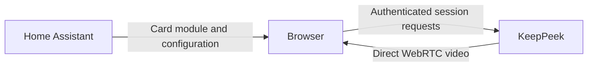

# Home Assistant card

This chapter covers installing, configuring, securing, and testing `custom:keeppeek-card`, the direct browser-to-KeepPeek Lovelace live-video card (`ui/home-assistant/`). Home Assistant serves the card module and dashboard config while the viewer browser connects directly to KeepPeek over HTTPS and WebRTC—no Home Assistant backend integration, media proxy, or iframe is required.



| Scope                | Details                                                                                                                                                                                                                                                                  |
| -------------------- | ------------------------------------------------------------------------------------------------------------------------------------------------------------------------------------------------------------------------------------------------------------------------ |
| **Supported**        | Live video, visual editor (**Load sources**), camera selection, `grid` and `single` layouts, focus, shared connections, HA theme matching.                                                                                                                               |
| **Not in this card** | Audio, PTZ, event ribbons, timeline playback, Home Assistant entity discovery. Use KeepPeek for playback ([Recording and evidence](./recording-and-evidence.md)) and MQTT for automation events ([Notifications and integrations](./notifications-and-integrations.md)). |

## Prepare KeepPeek

1. Verify the target cameras play in KeepPeek.
2. Create a dedicated **User** credential with the intended camera grants in **Settings > Access** ([Authentication and access control](./authentication.md)).
3. Ensure both the KeepPeek HTTP endpoint and its advertised WebRTC addresses are reachable from the dashboard browser. Home Assistant Cloud does not relay card media; prefer a private VPN over public exposure.
4. Add every exact Home Assistant browser origin (`scheme://host[:port]`, no path or trailing slash) to `[direct_card]` in `config.toml`, then restart KeepPeek:

```toml
[direct_card]
allowed_origins = [
  "https://home.example.net",
  "https://homeassistant.local:8123",
]
```

Use browser-trusted HTTPS in normal deployments—HTTP is permitted only for `localhost`, `127.0.0.1`, or `[::1]` development. Keep credentials out of endpoint URLs. KeepPeek enables credentialless CORS (`POST`, `OPTIONS`, `Authorization`, `Content-Type`, `Content-Encoding`; no cookies, never wildcard `*`) on `/create` and `/delete` for configured origins only. See [Configuration reference](./configuration-reference.md).

## Install, upgrade, and roll back

Each release provides a self-contained ES module (`keeppeek.js` bundling Svelte, protobuf runtime, icons, and CSS with zero third-party runtime fetches) plus `keeppeek-card.json` (version, SHA-256 checksum, byte counts).

### HACS installation

1. Select a [KeepPeek release](https://github.com/xnorpx/keeppeek/releases) that includes `keeppeek.js` and `keeppeek-card.json`.
2. In HACS, add `https://github.com/xnorpx/keeppeek` as a custom **Dashboard** repository.
3. Download the release. If HACS does not auto-register it, add `/hacsfiles/keeppeek/keeppeek.js` as a **JavaScript module** dashboard resource.
4. Reload the dashboard and pick **KeepPeek** in the card picker.

`hacs.json` targets release assets and hides default-branch downloads; a local build is not installable through HACS, and custom-repository installation is distinct from HACS default-store inclusion.

### Manual installation

1. Download `keeppeek.js` and `keeppeek-card.json` from a release, or build locally from the repo root with `bun run --cwd ui build:home-assistant` (outputs to `target/home-assistant-card/dist/`).
2. Verify `keeppeek.js` SHA-256 against `keeppeek-card.json`.
3. Copy `keeppeek.js` into Home Assistant's `www/` folder (restart Home Assistant if creating `www/` for the first time).
4. Register `/local/keeppeek.js?v=VERSION` as a **JavaScript module** resource and reload.

### Upgrade and rollback

Switch versions in HACS, or replace `www/keeppeek.js` and update the `?v=` query suffix, then reload all open dashboard tabs to release old sessions. Keep the card and KeepPeek server on compatible pre-1.0 releases, and never register two versions of the resource simultaneously.

## Configure the card

In YAML-mode dashboards, store the dedicated key in Home Assistant's `secrets.yaml` (distinct from KeepPeek's `secrets.toml`) and reference it with `!secret`:

```yaml
type: custom:keeppeek-card
endpoint: https://keeppeek.example.net
token: !secret keeppeek_lovelace_token
title: Entrances
sources:
  - source_id: "192.168.1.20"
    title: Front door
    quality: auto
  - source_id: "192.168.1.21"
    title: Driveway
    quality: low
layout: grid
columns: 2
aspect_ratio: "16:9"
show_name: true
```

In the visual editor, enter the endpoint and key, then click **Load sources** to discover visible cameras without subscribing to video. For storage-mode dashboards, enter the key directly in the editor—the existing key is never read back (an empty field with a configured placeholder preserves it; enter a replacement or use the clear action to change it). Always use KeepPeek's stable `source_id`, not display names or Home Assistant entity IDs.

| Option                | Default           | Limits & behavior                                                                                              |
| --------------------- | ----------------- | -------------------------------------------------------------------------------------------------------------- |
| `endpoint`            | Required          | HTTPS base URL (`<= 2,048` chars, no userinfo/query/fragment); HTTP allowed only on loopback dev hosts.        |
| `token`               | Required          | Resolved KeepPeek access key (`!secret` is resolved by Home Assistant, not the card).                          |
| `sources`             | Required          | 1 to 16 unique source objects. Start with 1 camera—16 valid entries do not guarantee 16-stream browser decode. |
| `sources[].source_id` | Required          | Nonblank stable source ID (`<= 160` chars).                                                                    |
| `sources[].title`     | Camera name or ID | Optional nonblank label below video (`<= 160` chars).                                                          |
| `sources[].quality`   | `auto`            | `auto`, `low`, or `high` from server-advertised variants.                                                      |
| `title`               | `KeepPeek`        | Optional card heading (`<= 160` chars).                                                                        |
| `layout`              | `grid`            | `grid` shows all selected sources; `single` adds a camera selector.                                            |
| `columns`             | `2`               | Integer `1..4`, capped at visible camera count; stacks to 1 column below `440 px`.                             |
| `aspect_ratio`        | `16:9`            | `16:9`, `4:3`, or `1:1` (contained, never cropped).                                                            |
| `show_name`           | `true`            | Displays camera names below video.                                                                             |
| `view`                | `live`            | Only `live` is supported.                                                                                      |

The editor preserves source titles, quality choices, and unrelated Home Assistant layout metadata (such as `grid_options`).

## Video walkthrough

This walkthrough demonstrates the Lovelace visual editor and live `custom:keeppeek-card` `grid`, `single`, and focus controls.

<video controls crossorigin="anonymous" preload="metadata" playsinline style="width: 100%; height: auto">
  <source src="https://keeppeekdemos.blob.core.windows.net/demo-videos/demos/assets/home-assistant.desktop.card.mp4" type="video/mp4">
  <track src="https://keeppeekdemos.blob.core.windows.net/demo-videos/demos/assets/home-assistant.desktop.card.vtt" kind="captions" srclang="en" label="English">
  <a href="https://keeppeekdemos.blob.core.windows.net/demo-videos/demos/assets/home-assistant.desktop.card.mp4">Download the Home Assistant card demo</a>.
</video>

## Security boundary

- **Browser trust boundary**: The resolved key necessarily reaches the browser. YAML `!secret` organizes config but does not hide the key from dashboard editors, third-party frontend modules, or browser DevTools network headers. Use a dedicated **User** key, never an **Administrator** key, unless every viewer should hold admin rights.
- **Memory-only handling**: The card keeps the key and its `SHA-256` connection fingerprint in memory only—never in URLs, browser storage, rendered HTML, console logs, or diagnostics.
- **Authorization lives on KeepPeek**: `sources` is a display filter, not access control. KeepPeek's trusted-local policy still grants **Administrator** access to browsers inside `access.local_networks` even when they send a User key—narrow `access.local_networks` and test restrictive grants from a remote-classified browser. CORS is not authentication.
- **Revocation**: Rotating, disabling, revoking, or expiring the key invalidates active sessions per server policy; auth failures stop automatic card retries until the key is updated.

## Connection sharing, lifecycle, and troubleshooting

Cards in the same browser document share one WebRTC session per normalized `(endpoint, SHA-256(token))` and share one media subscription for identical `(source_id, quality)` pairs. Different credentials never share media.

| Limit / lifecycle behavior | Bound / rule                                                                                                                                 |
| -------------------------- | -------------------------------------------------------------------------------------------------------------------------------------------- |
| Sharing bounds             | Up to **8** connection identities/dashboard, **64** consumers/identity, **16** distinct source/quality subscriptions/connection.             |
| Operations & retries       | **10s** timeout per HTTP/negotiation/RPC operation, max **32** pending RPCs, backoff `1→2→4→8→16→30s` (max **8** automatic attempts).        |
| Demand & cleanup           | Hidden tabs, offscreen/removed cards, and selection changes release demand; removing the final consumer closes the peer and calls `/delete`. |
| Layout & theme updates     | Theme changes do not reconnect. Lovelace responsive column reflows can detach/reattach cards and trigger a clean reconnect.                  |

| Symptom                  | What to check                                                                                                                                                                                       |
| ------------------------ | --------------------------------------------------------------------------------------------------------------------------------------------------------------------------------------------------- |
| Card missing from picker | Confirm module path and **JavaScript module** resource URL, then reload.                                                                                                                            |
| Connection fails         | Check endpoint, TLS cert, exact `allowed_origins`, and Chromium **Local Network Access** permission (browsers report all four as an indistinguishable fetch error; never disable browser security). |
| Access denied            | Verify the dedicated key is enabled and unexpired in KeepPeek.                                                                                                                                      |
| Unknown source ID        | Click **Load sources** in the visual editor and select an ID visible to this credential.                                                                                                            |
| One camera offline       | Inspect that camera in KeepPeek; other sources continue independently.                                                                                                                              |
| Video does not play      | Verify browser codec support and reachability of KeepPeek's advertised WebRTC addresses.                                                                                                            |

## Test locally and in CI

| Check                                    | Commands (from repository root)                                                 | Scope                                                                                                                                                                                                                |
| ---------------------------------------- | ------------------------------------------------------------------------------- | -------------------------------------------------------------------------------------------------------------------------------------------------------------------------------------------------------------------- |
| **Lightweight Lovelace harness preview** | `bun run --cwd ui test:e2e:prepare` then `bun run --cwd ui demo:home-assistant` | Real KeepPeek + 2 synthetic RTSP cameras in an emulated dashboard shell; zero impact on operator config.                                                                                                             |
| **Real Home Assistant container suite**  | `bun run --cwd ui test:home-assistant-container` (or `:run` to reuse artifacts) | Docker + Playwright Chromium against official HA `2026.9.1` (pinned multi-arch digest; 2 CPUs, 2 GiB, loopback-only, non-privileged, auto-cleanup). KeepPeek, cameras, and Chromium run on host to avoid Docker NAT. |

The **Home Assistant Container** Ubuntu CI job is required by the UI gate (normal `./check.sh` stays Docker-free and typechecks the suite). macOS ARM64 Docker Desktop works for local development testing only and is not a supported Home Assistant production deployment target. Local container tests do not replace post-release HACS install, upgrade, and rollback verification. See the [detailed Home Assistant card reference](https://github.com/xnorpx/keeppeek/blob/main/docs/home-assistant.md) for full transport and test details.
