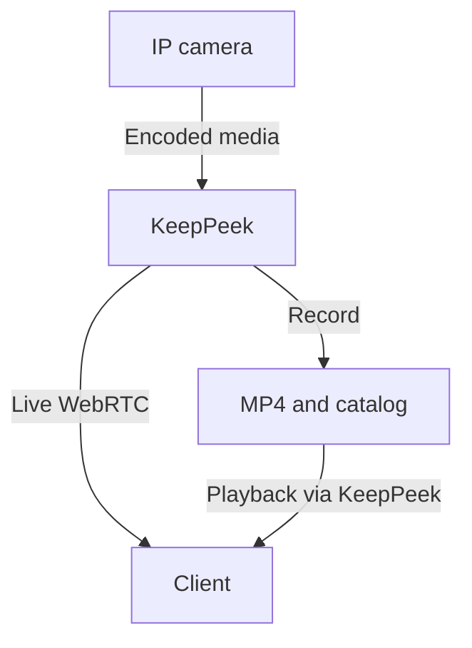
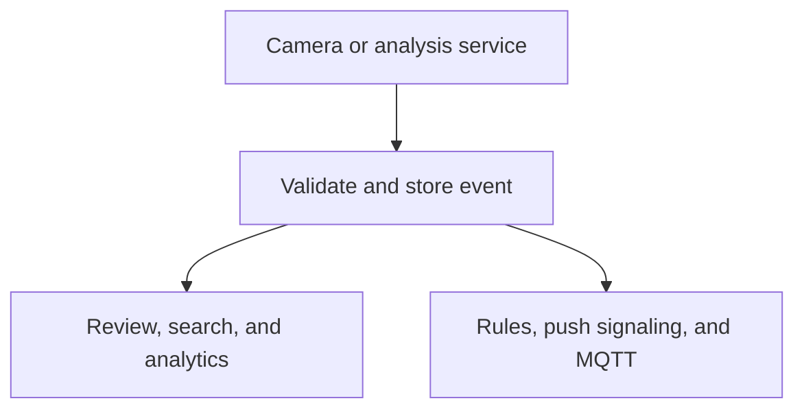

# How KeepPeek works

This page explains KeepPeek's runtime architecture, media and event pipelines, persistent state boundaries, and protocol surfaces. Use [Users and design choices](./users-and-design-choices.md) for product rationale and [Feature guide and navigation](./feature-guide.md) for UI navigation.

KeepPeek runs recording, live media routing, event storage, and investigation in one local Rust service. Browsers and `keeppeek-desktop` are clients of that service: closing a tab or desktop window ends viewing work without stopping the server's configured recording policy.

## Media and event paths

Cameras supply encoded video (H.264 or H.265) and supported audio. KeepPeek parses codecs and timing to route, index, and write fragmented ISO MP4 segments without decoding or re-encoding video in the core ingest path; browsers and external services perform their own decoding. (When optional silent MP4 timelapse export is enabled and a user-installed `ffmpeg` binary is present, KeepPeek runs that external encoder incrementally outside the recording ingest path.)

Camera control, native events, and media can use separate protocol connections, so health on one path does not prove the others are working. Native adapters (Reolink Baichuan, Hikvision/Annke ISAPI, ONVIF PullPoint, RTSP metadata) and optional external WebRTC analysis services publish events into a separate pipeline:

The server isolates camera ingest, storage writes, WebRTC sessions, and outbound notification or MQTT delivery. Bounded queues and explicit health states keep stalls visible; optional analysis, notifications, and MQTT never become prerequisites for ordinary recording.

## Persistent state vs. runtime memory

KeepPeek keeps configuration in `config.toml` and reusable private strings in the companion `secrets.toml` using `{secret:KEY}` and `{secret:KEY|url}` references; do not create separate settings files for layouts, permissions, or desktop targets. See [Configuration reference](./configuration-reference.md) for exact schemas and [Backup and restore](./backup-and-restore.md#what-survives-a-restart) for restart guarantees.

| Store or state                                    | Owner and persistence                                                                                                                                                            | Operational consequence                                                                                                |
| ------------------------------------------------- | -------------------------------------------------------------------------------------------------------------------------------------------------------------------------------- | ---------------------------------------------------------------------------------------------------------------------- |
| **Application configuration** (`config.toml`)     | Persisted settings, cameras, storage policies, runtime profiles, saved layouts, access policy, notification rules, usage-reporting consent, and optional `[desktop].server_url`. | Edit through validated saves or configuration ZIP apply; preserve across upgrades.                                     |
| **Reusable secrets** (`secrets.toml`)             | Companion store for named and URL-encoded secret references.                                                                                                                     | KeepPeek preserves references instead of writing resolved secrets into `config.toml`; protect ZIP exports and backups. |
| **Encoded recordings** (`.mp4`, `.mp4.active`)    | Fragmented ISO MP4 files across configured storage paths and named storage volumes.                                                                                              | Retention, recording policy, storage pressure, and file integrity determine what remains playable.                     |
| **Fourth-tier local archive**                     | Verified replica MP4s on an optional confined local destination.                                                                                                                 | Extends retention independently of ingest; recover catalog manifests and archive root together.                        |
| **Recording and event catalog** (`recordings.db`) | Indexed recording identity, coverage, events, bookmarks, saved searches, activity rollups, export jobs, and guest review grants.                                                 | Back up and recover consistently with media files; see [Recording archive recovery](./recording-archive-recovery.md).  |
| **Event images and exports**                      | Feature-owned thumbnails, clip exports, and timelapse MP4/manifest artifacts under configured paths.                                                                             | Playable recordings do not guarantee that thumbnails or expired export artifacts remain.                               |
| **Notification, MQTT, and access runtime state**  | Bounded process memory for notification inbox/history/retries, MQTT pending outbox/deduplication, active sessions, and access audit/last-use activity.                           | **Resets on restart** without replaying pending deliveries; persisted rules and credentials remain durable.            |
| **Active connections and subscriptions**          | Ephemeral server and client session state (WebRTC peers, camera workers, subscriptions).                                                                                         | Reconnect resolves current capabilities; a stored preference never proves a stream is live.                            |

## Control, media, and access plane

| Surface              | Transport and contract                                                                                             | Responsibilities                                                                                                                                                                                                                                                                                                                                                                          |
| -------------------- | ------------------------------------------------------------------------------------------------------------------ | ----------------------------------------------------------------------------------------------------------------------------------------------------------------------------------------------------------------------------------------------------------------------------------------------------------------------------------------------------------------------------------------- |
| **WebRTC sessions**  | RTP/UDP + SCTP data channels ([`api/webrtc.proto`](https://github.com/xnorpx/keeppeek/blob/main/api/webrtc.proto)) | Live video/audio, stored playback, typed protobuf control, capability negotiation, event search/analytics, and external media/event subscriptions.                                                                                                                                                                                                                                        |
| **HTTP routes**      | Dedicated REST endpoints ([`api/openapi.yaml`](https://github.com/xnorpx/keeppeek/blob/main/api/openapi.yaml))     | Session and OIDC auth (`/auth/session`, `/auth/login`, `/auth/callback`, `/auth/logout`), WebRTC signaling (`/create`, `/delete`), config ZIP export/apply (`/config/export`, `/config/apply`), backups (`/api/backups/*`), guest review (`/share`), logs (`/logs`, `/logs/snapshot`), bug reporting (`/reporting/*`), coverage (`/recording-coverage`), and Prometheus (`GET /metrics`). |
| **Operator clients** | Browser UI, `keeppeek-desktop`, foreground TUI                                                                     | Static Svelte 5 app served by KeepPeek, optional Tauri v2 desktop window on Windows/macOS, and terminal health dashboard on interactive TTY runs.                                                                                                                                                                                                                                         |

HTTP routes complement WebRTC rather than replacing the WebRTC control protocol. Clients must negotiate capabilities and source identities at runtime instead of assuming identical streams, codecs, controls, or events across cameras. The API is pre-1.0 and does not yet promise cross-version stability; start with the [API overview](https://github.com/xnorpx/keeppeek/blob/main/api/README.md).

Authentication identifies the caller (local trusted network, named credential, or external OIDC provider); authorization enforces Administrator vs. User roles and per-camera/group grants uniformly across dashboards, deep links, WebRTC commands, and HTTP routes. A hidden UI control is never the security boundary ([Authentication](./authentication.md)).

## Recording truth and diagnostics

Keep these four diagnostic layers separate so a browser playback issue does not trigger unnecessary storage repair:

1. **Live stream health:** Confirms camera transport and incoming frames, not disk writes.
2. **Recorded coverage:** Confirms cataloged MP4 intervals and gaps for a camera and UTC day.
3. **Events and analytics:** Confirms validated event metadata; a retained event can outlive its thumbnail or underlying video.
4. **Stored integrity and exports:** Confirms persisted MP4 containers, catalog alignment, and independently verifiable export bytes.

Start troubleshooting in [Camera and stream health](./camera-health.md) and [Recording and evidence](./recording-and-evidence.md); run [Recording maintenance](./recording-maintenance.md) only when stored-data evidence warrants it.

## Extension boundaries and codebase map

External analysis services subscribe to WebRTC media and publish normalized events without receiving camera credentials or direct access to SQLite or recording directories. The Home Assistant card connects the browser directly to KeepPeek instead of proxying video through Home Assistant. Declared protocol types without server handlers—such as live [participant groups](./groups.md)—are unavailable until their runtime contract ships.

| Entry point                                                                                       | Responsibility                                                                      |
| ------------------------------------------------------------------------------------------------- | ----------------------------------------------------------------------------------- |
| [`src/app.rs`](https://github.com/xnorpx/keeppeek/blob/main/src/app.rs)                           | Application startup, subsystem wiring, and lifecycle orchestration.                 |
| [`src/server.rs`](https://github.com/xnorpx/keeppeek/blob/main/src/server.rs)                     | HTTP routing, auth, config export/apply, backups, diagnostics, and `/metrics`.      |
| [`src/webrtc.rs`](https://github.com/xnorpx/keeppeek/blob/main/src/webrtc.rs)                     | WebRTC peer management, media forwarding, and protobuf control dispatch.            |
| [`src/storage`](https://github.com/xnorpx/keeppeek/tree/main/src/storage)                         | Fragmented MP4 recording, SQLite catalog, volumes, archive, timelapse, and exports. |
| [`src/tui`](https://github.com/xnorpx/keeppeek/tree/main/src/tui)                                 | Foreground terminal health dashboard.                                               |
| [`crates/keeppeek-desktop`](https://github.com/xnorpx/keeppeek/tree/main/crates/keeppeek-desktop) | Optional Windows and macOS Tauri desktop client.                                    |

For build, test, and contribution rules, see [Contributing](./contributing.md).
