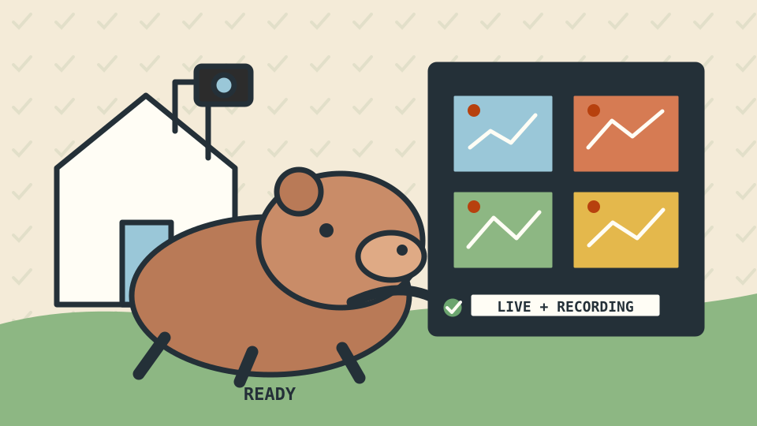
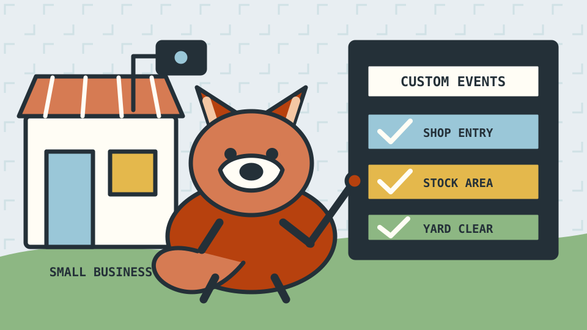
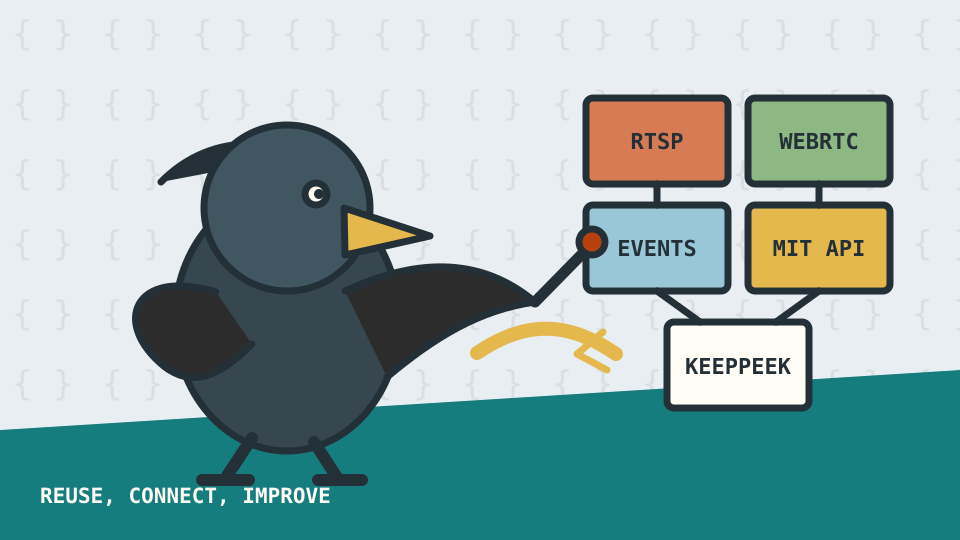
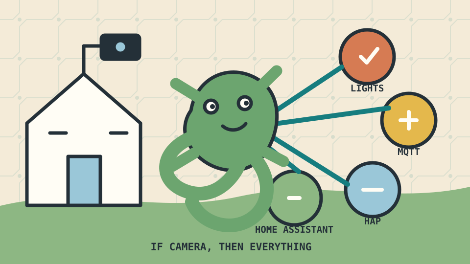
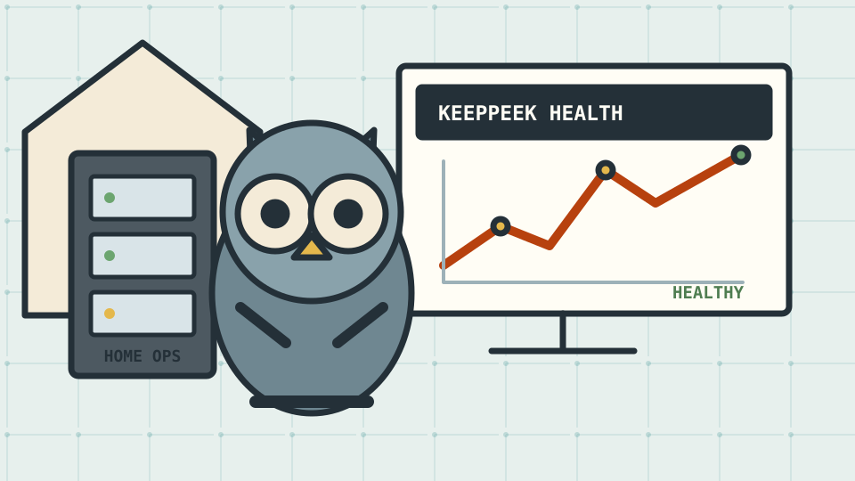
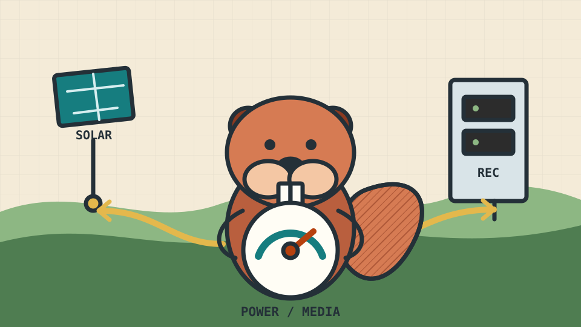
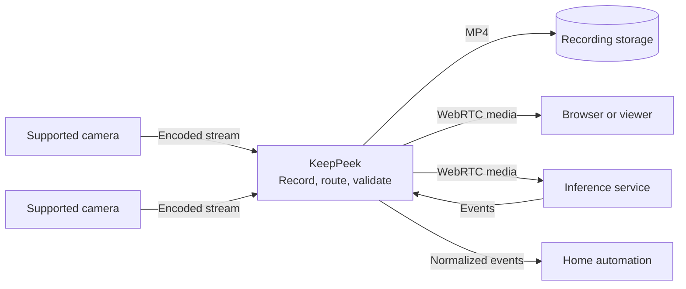

# Users and design choices

This page explains who KeepPeek is built for, how it decides which cameras and protocols to support, and the architectural trade-offs and non-goals behind the recorder. It records product rationale and intended boundaries; use the [feature guide](./feature-guide.md) for current screen availability, [How KeepPeek works](./how-it-works.md) for runtime behavior, and [release readiness](./release-readiness.md) for Alpha qualification limits.

KeepPeek is a local-first network video recorder and WebRTC media gateway with a deliberately narrow center: ingest camera media, record it reliably as standard MP4, serve live and recorded streams, and provide a stable boundary for camera-native or external events. Inference frameworks, models, accelerators, and licensing change much faster than a recorder should, so KeepPeek exposes an open protocol instead of forcing one AI stack into every installation.

## Target users

| User                                        | Starting point                                                             | Primary priority                                 | KeepPeek's role                                                             |
| ------------------------------------------- | -------------------------------------------------------------------------- | ------------------------------------------------ | --------------------------------------------------------------------------- |
| **Software Consumer**                       | [Common cameras](#cameras-brands-and-protocols) and a home monitoring goal | Sensible defaults and dependable playback        | Complete first-party recording, live wall, and review experience            |
| **Small Business Security**                 | Shop, office, workshop, or yard with domain-specific risks                 | Relevant alerts and portable evidence            | Stable recorder core plus open boundary for tailored inference              |
| **Open Source Enthusiast**                  | Existing self-hosted tools and reusable components                         | Inspectability and replaceable parts             | Composable open core (AGPL server, MIT API) without vendor lock-in          |
| **Home Automation Enthusiast**              | Home Assistant, MQTT, HAP, and household automations                       | Local orchestration and stable device identities | Camera and event source without proxying video through the hub              |
| **Residential Sysadmin**                    | Home server, NAS, container host, or monitoring stack                      | Predictable operations and clear diagnostics     | Native service with reason codes, bounded logs, and `/metrics`              |
| **Residential Power Optimization Engineer** | Mixed cameras and compute hosts with power/heat limits                     | Deliberate workload placement and efficiency     | Low-overhead media plane that feeds whichever host should decode or analyze |

### Software Consumer

> _I just want it to work._



- **Workflow:** Install KeepPeek, run guided camera setup with safe defaults, watch live/recorded footage in the Svelte web UI or desktop app, and act on clear diagnoses rather than raw protocol errors.
- **Product implication:** Optional architecture stays out of the way until needed; core recording works without a cloud account, AI subscription, or accelerator setup. Start with [Get started](./get-started.md), then verify [camera health](./camera-health.md) and [recording coverage](./recording-and-evidence.md).

### Small Business Security

> _Custom detection for the way the business actually works._



- **Workflow:** Run KeepPeek for local recording and portable MP4 evidence, attach an external inference service tuned to business-specific objects, zones, and schedules over WebRTC, and route resulting events into timelines, notifications, MQTT, or webhooks.
- **Product implication:** Custom business logic lives in an external protocol plugin rather than a private recorder fork, keeping camera credentials and storage ownership inside KeepPeek while recording stays independent of model changes. Need a tailored deployment or custom inference integration? Contact KeepPeek to discuss business-specific requirements.

### Open Source Enthusiast

> _Because someone else already wrote it._



- **Workflow:** Deploy KeepPeek alongside existing self-hosted software, inspect the wire contract and generated bindings, and attach or swap independent detectors, transcoders, forwarders, or viewers.
- **Product implication:** The [licensing model](./open-source-and-licensing.md#licensing-model) (AGPL server, MIT API) protects server improvements while letting external clients and services choose their own licenses and business models.

### Home Automation Enthusiast

> _Because the porch light should have opinions._



- **Workflow:** Embed direct WebRTC views in Home Assistant, trigger automations from normalized MQTT events or webhooks, optionally expose cameras to Apple Home through an independent HAP bridge, and monitor health via Prometheus.
- **Product implication:** KeepPeek maintains stable source IDs, normalized event semantics, direct browser media, and explicit integration boundaries without trying to replace an automation hub.

### Residential Sysadmin

> _Unnecessarily professional._



- **Workflow:** Run one native service or container, validate every camera before trusting it, monitor explicit server/storage/stream/WebRTC health evidence and bounded logs, and separate transport failures from storage issues.
- **Product implication:** KeepPeek exposes stable health reason codes, structured logs, Prometheus metrics, and validated configuration/backup workflows in a predictable Rust binary.

### Residential Power Optimization Engineer



- **Workflow:** Place KeepPeek near cameras and disks, record camera-native encoded streams without local inference overhead, and subscribe to WebRTC media from whichever host (GPU box, desktop, or repurposed edge device) should decode or analyze it.
- **Product implication:** The core stays observable and lightweight, and its media boundary never assumes decoding or inference runs on the recording host.

## Cameras, brands, and protocols

Mixed-vendor fleets are normal in homes and small businesses. Compatibility is therefore defined by verified protocols and validated media—never by a brand logo alone. A discovered device is a candidate, not proof that authentication, streaming, controls, or events work.

### Brand integration paths

| Camera family                               | Integration path                                                                                            | Current meaning                                                                                                                                                                         |
| ------------------------------------------- | ----------------------------------------------------------------------------------------------------------- | --------------------------------------------------------------------------------------------------------------------------------------------------------------------------------------- |
| **Reolink**                                 | Dedicated `reo-proto` backend for Baichuan over TCP or UDP, with ONVIF and RTSP fallback paths              | First-class discovery, authentication, main/sub media, supported controls (including confirmed-speaker **Talk**), and native camera events                                              |
| **Dahua and compatible OEM/rebrand models** | ONVIF discovery and profile queries with RTSP media through Retina or explicit stream URLs                  | Supported standards-based family covering common H.264/AAC and H.265/G.711 patterns; each OEM model and firmware still requires validation                                              |
| **Tapo (supported models)**                 | ONVIF discovery and profile queries where available, with RTSP media through Retina or explicit stream URLs | Supported mainstream vendor through the standards path; exact capabilities depend on model and firmware                                                                                 |
| **Hikvision / Annke**                       | SADP discovery, ONVIF/RTSP media, and a plain-Rust ISAPI event worker                                       | Native event support depends on model, firmware, channel mapping, and enabled device rules; see [Hikvision ISAPI](https://github.com/xnorpx/keeppeek/blob/main/docs/hikvision-isapi.md) |
| **Other ONVIF cameras**                     | ONVIF discovery and device/profile queries, then RTSP media                                                 | Support depends on the device's standards implementation and must be validated per model                                                                                                |
| **Generic or unknown cameras**              | Explicit main and/or sub RTSP URLs                                                                          | Recording works without a recognized brand; discovery, controls, metadata, and native events may be unavailable                                                                         |

### Pragmatic support tiers

KeepPeek deliberately targets strong support for a well-known subset rather than claiming universal compatibility across every cloud-only or non-standard camera. New vendor support is added from measured evidence and maintainable protocol paths, not one-off device hacks:

1. **Supported vendor and model:** Documented firmware and config pass discovery/manual setup, authentication, main/sub streaming, keyframe detection, finalized MP4 recording, and independent playback validation.
2. **Protocol-compatible camera:** Exposes usable ONVIF/RTSP behavior, but the exact model has not yet earned a maintained compatibility claim.
3. **Manual RTSP camera:** Records a validated explicit stream URL even when discovery, controls, metadata, and native events are absent.

### Protocol responsibilities and media policy

| Responsibility                  | Protocol or component                                                            | Role in KeepPeek                                                                              |
| ------------------------------- | -------------------------------------------------------------------------------- | --------------------------------------------------------------------------------------------- |
| **Discovery**                   | ONVIF WS-Discovery, Reolink discovery, Hikvision SADP, bounded local port probes | Find candidate devices and collect safe identity hints                                        |
| **Device queries and control**  | ONVIF SOAP plus supported Reolink HTTP or Baichuan commands                      | Read device info, profiles, capabilities, imaging state, PTZ, and supported speaker talkback  |
| **Generic media ingest**        | RTSP/RTP through Retina (TCP or UDP)                                             | Receive standards-based media, including explicit main/sub URLs                               |
| **Reolink media ingest**        | Baichuan through `reo-proto` (TCP or UDP)                                        | Receive complete Reolink video and audio frames without requiring RTSP                        |
| **Native camera events**        | Reolink Baichuan, Hikvision/Annke ISAPI, ONVIF PullPoint, and RTSP metadata      | Normalize camera alarms into stored/live events using explicit event evidence                 |
| **Viewer and service delivery** | WebRTC (RTP/UDP + SCTP data channels)                                            | Deliver live/recorded media, protobuf control, and events without exposing camera credentials |

KeepPeek accepts H.264 and H.265 video plus AAC, G.711 A-law, G.711 mu-law, and ADPCM audio, recording camera-native main and sub streams without re-encoding. Automatic backend selection picks `reo-proto` for Reolink and Retina otherwise; TCP is the conservative default, UDP remains available when validated, and explicit RTSP URLs override ONVIF-discovered URLs. Camera setup verifies credentials, incoming keyframes, finalized MP4 output, and independent decode before recommending a live configuration.

## Key design choices

### Keep inference outside the server

KeepPeek does not bundle object detection, face recognition, license-plate recognition, or model management. Installations choose independently among three modes: **recording only** (no analytics), **camera-native analytics** (device alarms stored alongside media), or **external analytics** (separate service subscribing over WebRTC and publishing normalized events). The repository's [Python object-detection example](https://github.com/xnorpx/keeppeek/tree/main/examples/object_detection_service) demonstrates the external path using `aiortc` and a user-installed FFmpeg binary as a CI reference, not a supported detector product.

KeepPeek forwards **encoded streams rather than per-frame inference JPEGs**:

```text
Snapshot polling (rejected):  camera -> KeepPeek decode -> JPEG encode -> HTTP upload -> detector decode -> model
KeepPeek media gateway:       camera -> KeepPeek encoded forwarding -> detector decode & sample -> model
```

Avoided snapshot polling removes video decoding, pixel conversion, JPEG allocation, and repeated decode/encode hops from the core recorder. External detectors keep one hardware-appropriate decoder beside the model, choose their own sampling rate, and drop stale frames. JPEG remains useful strictly as bounded post-inference event evidence attached to a durable event.

### Keep recording and media routing at the center

KeepPeek owns the slow-changing, durable responsibilities: ingest, MP4 recording, stable source identities, timelines, health evidence, authorization, and event validation. External inference and transcoding services consume media through the gateway rather than opening camera sessions or touching SQLite or recording directories directly, ensuring recording continues even if optional services stall or go offline.

### Use WebRTC as the client and service gateway



WebRTC is the downstream gateway protocol, not a requirement imposed on cameras. It is built into browsers and has interoperable libraries across major service languages—Rust ([str0m](https://github.com/algesten/str0m), used by KeepPeek), Python ([aiortc](https://github.com/aiortc/aiortc)), C++ ([libwebrtc](https://webrtc.googlesource.com/src/)), and Node/TypeScript ([werift](https://github.com/shinyoshiaki/werift-webrtc))—so clients and detectors can pick the stack and hardware (server, GPU host, or repurposed mobile/edge device) that fits them without ever receiving camera credentials. Inside one session, **RTP over UDP** carries low-latency media while **SCTP data channels** carry ordered protobuf control and binary payloads.

### Fit into home automation instead of replacing it

| Integration        | Connection boundary                                                                    | Status and role                                                                                                               |
| ------------------ | -------------------------------------------------------------------------------------- | ----------------------------------------------------------------------------------------------------------------------------- |
| **Home Assistant** | Lovelace card connects the browser directly to KeepPeek over WebRTC                    | **Shipped card** for live cameras without proxying video through Home Assistant; optional entity integration remains separate |
| **MQTT**           | Built-in data-only MQTT 5 event forwarder configured in **Settings > Integrations**    | **Shipped**; publishes normalized events and optional snapshots to an existing broker without decoding video                  |
| **Prometheus**     | Monitoring stack scrapes `GET /metrics`                                                | **Shipped**; exposes server, storage, camera, stream, recording, and WebRTC telemetry                                         |
| **HomeKit (HAP)**  | Independent external bridge translating KeepPeek capabilities into HomeKit accessories | **Intended boundary (not in core)**; keeps HomeKit credentials and quirks outside the recorder                                |

### Store recordings as standard MP4

Recordings use fragmented ISO MP4 (`.mp4.active` while recording, finalized to `.mp4` without remuxing). Initialization metadata followed by keyframe-aligned fragments allows safe flushing, exact byte-range timeline seeks, and direct playback or inspection in VLC, FFmpeg, and `ffprobe` without KeepPeek installed. The SQLite catalog indexes metadata and fragments for fast lookup, while encoded footage stays in ordinary files on disk. MP4 is a container, not a codec: playing an H.265 `.mp4` still requires an H.265-capable player.

### Keep video codecs out of the core service

KeepPeek is codec-aware (parsing H.264/H.265 framing, configuration, and keyframes) without bundling video decoders or encoders. Excluding codec packs avoids jurisdiction-dependent patent/licensing entanglement, large native attack surfaces, and unnecessary CPU/memory overhead. On desktop and mobile, the Svelte UI queries browser/OS codec support (`Chrome`/`Chromium`, Windows `WebView2`, macOS `WKWebView`) and selects a compatible stream; keep an H.264 substream for universal playback, or attach an independent transcoder that publishes a compatible variant through the gateway. Optional silent MP4 timelapse export is capability-gated on a host-installed external `ffmpeg` binary rather than bundled codecs.

### Core stack, footprint, and cross-platform packaging

| Decision                | Rationale                                                                                                                               | Trade-off / boundary                                                                                                                                                                                                                      |
| ----------------------- | --------------------------------------------------------------------------------------------------------------------------------------- | ----------------------------------------------------------------------------------------------------------------------------------------------------------------------------------------------------------------------------------------- |
| **Rust server**         | Memory-safe, GC-free concurrent parsing of untrusted network/media streams across Linux, macOS, and Windows.                            | Steeper contribution curve and longer compile times accepted for runtime reliability.                                                                                                                                                     |
| **Small, focused core** | Keeps inference runtimes, weights, codec packs, and an Electron browser out of the server binary.                                       | Baseline RAM stays modest, while the configurable **encoded pre-event cache** scales intentionally with stream count, bitrates, profiles, and pre-event duration; no hard total-RAM guarantee is published without workload measurements. |
| **Svelte 5 static UI**  | Compiled reactivity and generated TypeScript protobuf bindings with no second web application server.                                   | Adds a frontend toolchain, but isolates UI work from the media process and works identically across host OSes.                                                                                                                            |
| **AI-assistable setup** | Structured config, stable reason codes, and the repo's Camera Setup Skill make discovery/validation scriptable by humans or assistants. | Running the recorder never requires AI; setup skills keep secrets out of chat, stage config, validate MP4s, and require human approval before modifying camera settings.                                                                  |

KeepPeek maintains identical core behavior across platforms while packaging natively for each OS:

| Platform    | First-class distribution                                                                                                                                                                                                |
| ----------- | ----------------------------------------------------------------------------------------------------------------------------------------------------------------------------------------------------------------------- |
| **Linux**   | Multi-arch GHCR Docker image (`linux/amd64`, `linux/arm64`) with a persistent configuration volume (primary Linux path), plus native `linux-x86_64` and `linux-aarch64` archives.                                       |
| **macOS**   | Signed and notarized Apple Silicon (`aarch64`) `KeepPeek.app` DMG with a per-user `launchd` service, plus optional `KeepPeek Desktop.app` DMG (Tauri v2 client connecting to an existing server).                       |
| **Windows** | Authenticode-signed, RFC 3161 timestamped `x86_64` and `aarch64` binaries (`keeppeek.exe`, `keeppeek-service.exe`, `keeppeek-desktop.exe`) and a unified signed NSIS installer registering/upgrading `KeepPeekService`. |

## Connecting users to choices

| User                                        | Most relevant choices                                                                       | What those choices enable                                                               |
| ------------------------------------------- | ------------------------------------------------------------------------------------------- | --------------------------------------------------------------------------------------- |
| **Software Consumer**                       | Svelte UI + desktop app, common camera paths, MP4, browser decoding, setup Skill            | Install, record, review, and diagnose without assembling an integration stack           |
| **Small Business Security**                 | Stable recording core, encoded-stream inference, open API, external plugins                 | Commission tailored analytics and workflows without making evidence depend on the model |
| **Open Source Enthusiast**                  | AGPL server, MIT API, standard WebRTC, replaceable external services                        | Reuse, inspect, replace, and improve each component independently                       |
| **Home Automation Enthusiast**              | Stable identities, normalized events, Home Assistant card, MQTT 5, HAP boundary, `/metrics` | Connect cameras to dashboards, alerts, and automations without proxying video           |
| **Residential Sysadmin**                    | Rust, compact core, native packages/Docker, health evidence, standard MP4                   | Operate and recover a predictable service with standard infrastructure tools            |
| **Residential Power Optimization Engineer** | Encoded forwarding, external inference, browser decoding, flexible placement                | Put storage, decoding, inference, and integrations on the best host for power and heat  |

## Boundaries and non-goals

- KeepPeek is not a model host, training environment, detector marketplace, or GPU manager.
- KeepPeek does not expose periodic server-generated JPEGs as its inference API.
- Camera-native analytics must work without an external AI service; recording and viewing must not require camera AI, external AI, or cloud services.
- External services and plugins never receive camera credentials or direct access to SQLite databases or recording directories.
- The core service does not bundle a video decoder, encoder, codec pack, or packaged browser runtime.
- MP4 storage guarantees container portability, not that every player can decode every camera codec.
- No fixed total-RAM limit is promised before representative workload benchmarks; total memory includes the configured encoded pre-event cache.
- The MIT-licensed API permits independent commercial clients and services; it does not exempt private modifications to the AGPL server.
- KeepPeek does not replace Home Assistant, an MQTT broker, HomeKit, or a monitoring system.
- AI-assisted setup must remain reproducible by a person, protect secrets, and never modify camera settings silently.
